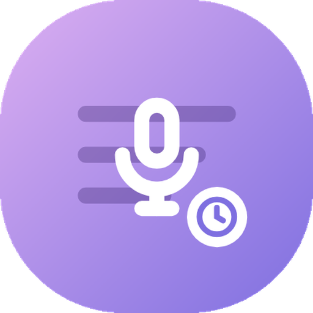

# Listen Later

Share a video to your podcast app. Listen Later is an Android companion
for a self-hosted [PigeonPod](https://github.com/aizhimou/pigeon-pod) server:
you share a video to it, the server's built-in Individual Videos feed picks
it up, and your podcast app plays it like any episode.

Inspired by the old [Listenbox](https://listenbox.app) Listen Later app (RIP).

## How it works

1. Sign in once with your server address and login.
2. Share a video to Listen Later from any app. One tap, nothing opens, a
   toast confirms it was sent.
3. The video shows up in your Individual Videos feed. The app's main screen
   has a Copy feed link button for subscribing to that feed in your podcast
   app.

The app never changes feed settings; quality, retention, and the rest stay
where you set them on your server's website.

## Install

Grab the APK from the [latest release](../../releases/latest) and install
it. You need a self-hosted PigeonPod server you can sign in to, and any
podcast app that can subscribe to an RSS feed.

Setup, privacy (including what the update check sends), and screenshots are
in [docs/details.md](docs/details.md).