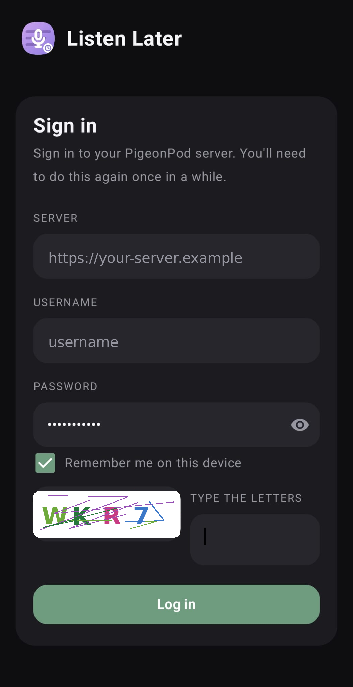

# Listen Later - details

Requires Android 12 or newer.

## Screenshots

  
  

## Setup

- A self-hosted [PigeonPod](https://github.com/aizhimou/pigeon-pod) server you can sign in to.
- Your server address (https only), username, and password. If your server
  asks for a captcha at login, the app shows the same picture.
- Any podcast app that can subscribe to an RSS feed.

## Install and updates

Download the APK from the [download page](https://mtndaleredneck.github.io/Listen-Later/),
open it, and allow installation from your browser or file manager if
Android asks. You need an existing PigeonPod server with an HTTPS address,
username and password. After signing in, tap "Copy feed link" and add that
link to your podcast app. The app offers new versions automatically; you
can also open the gear icon, then "Check for updates". Install updates over
the existing app without uninstalling it. Tap the server address on the
main screen to open your server in the browser.

## How it works

1. Sign in with your server address and login. When the session expires,
   the app asks you to sign in again. "Remember me on this device" (on by
   default) keeps the next sign-in prefilled, including across sign-out;
   unchecking it wipes the saved password.
2. Share a YouTube video to Listen Later, from YouTube or any app sharing
   its link (individual videos, not whole playlists). One tap, nothing
   opens. If you're signed out, the video is saved and you'll see "Saved.
   Open Listen Later and sign in to send it." If you're offline or your
   server can't be reached, it stays saved and keeps trying.
3. The video appears in your Individual Videos podcast feed. Subscribe to
   that feed once in your podcast app (the app has a Copy feed link button
   for the feed link) and new shares show up by themselves.

The app never changes feed settings. Quality, retention, and everything
else stay wherever you set them on your server's website. Sharing a video
that's still downloading shows "Already downloading". If an older video's
download was removed or failed, sharing it again can start another
download.

## Privacy

Your server address, login token, and feed link are stored only in the
Android Keystore-backed encrypted preferences on your phone. Your password
is stored in the same Keystore-encrypted storage only while "Remember me on
this device" is on (it is on by default); unchecking it wipes the saved
password. Signing out keeps the remembered login so the next sign-in is
prefilled. Your password is never written in plain text and never logged.

Video and feed requests go to your own server. When the signed-in main
screen opens, the app also checks GitHub for updates; you can check
manually in Settings. The check is one unauthenticated HTTPS GET to the
GitHub API asking for this app's latest public release. That request carries no body and no
credentials - just the ordinary HTTPS headers every client sends, including
a "ListenLater" user-agent - and none of your server, login, or feed data.
Like any HTTPS request it comes from your phone's IP address, which GitHub
sees. If you tap Update in the pop-up, the APK itself downloads from GitHub
over HTTPS. There is no switch for the update check; it is part of the app.

Settings also has Feedback. Before opening a public GitHub issue or a
private form, the app shows your message, app version, Android version and
phone model. Your server address and sign-in details are not added to the
report.

## Full delete (optional server add-on)

Press and hold a video in the list to delete it. The app first asks the server whether it
supports full delete. Stock PigeonPod (v1.31.0 was used) can't remove an entry: its own delete
only removes the downloaded files and the entry stays as "Get again". On a stock server the
app says "Full delete isn't available on this server" and changes nothing.

The add-on is optional. Everything else in the app works without it.

- Patch: `server/patches/individual-delete-stock.patch` (stock PigeonPod) or `server/patches/individual-delete-custom.patch` (after the two sign-in patches below). `server/README.md` has the apply order. It applies to PigeonPod v1.31.0 (commit
  b6e1a49) and adds two routes under `/api/episode/individual/`. It has no database changes.
- To use it: apply the patch to your PigeonPod source (`git apply`), rebuild your image, and
  restart. Back up your database and keep your previous image first so you can roll back.
  If you already carry other patches, apply this one last. Re-apply it after PigeonPod updates.
- Admin only: the delete route needs the PigeonPod admin account. A non-admin gets a plain error, and Listen Later shows "Couldn't delete. Try again." The server reports "still downloading" and "not in this feed" inside a normal HTTP 200 reply, as PigeonPod does for its other routes; the app reads that result code, never just the HTTP status.
- What it does: removes the video from the Individual Videos feed and deletes its files, unless
  it is downloading right now ("Still downloading. Try again shortly."). It can't be undone.
  Sharing the link again adds it fresh. Episodes your podcast app already downloaded are not touched.
- Status: the patch compiles and its tests pass (full server test suite, including tests that run
  against a real SQLite database with the shipped migrations: channel-owned and shared videos are
  only unlinked, a download starting mid-delete gives "Still downloading" and changes nothing).
  Both variants were also built and run in Docker from a clean checkout with synthetic data
  (`server/fixture/`): sign-in, the capability check, refusal when signed out, removed, already
  gone, still downloading, not in the feed, and shared (only unlinked) all behave as described.
  A real phone against a running server has not been tested.

Videos still waiting to send, or under "Couldn't get it", are removed from the list on the
phone only; nothing is sent to the server for them.

## Optional: staying signed in across server restarts (Tested on a clean fixture)

These two changes are independent of full delete and optional. Without them PigeonPod keeps
sign-ins in memory, so every server restart signs you out; Listen Later then asks you to sign in
again and keeps shared videos waiting meanwhile. Both are source patches against PigeonPod v1.31.0
(commit b6e1a49), in `server/patches/`, applied in this order: first `pigeon-0.4.diff` at the
repository root (`git apply -p1`), then `pigeon-0.5-fence.diff` inside `backend/`
(`git apply -p1`), then, if wanted, the custom full delete patch above.

- Redis sessions: upgrades Sa-Token from 1.44.0 to 1.46.0, adds the Redis session store, and
  answers HTTP 503 (not 401) when Redis is down, so Listen Later keeps your sign-in and retries.
- Sign-in fence: adds an `auth_version` column (a database migration that can't be undone) so a
  password change signs out older sessions.
- Setup: run Redis on an internal network with no published port, a password you generate, and
  `appendonly yes`. Give the app the standard Spring Boot settings `SPRING_DATA_REDIS_HOST`,
  `SPRING_DATA_REDIS_PORT` and `SPRING_DATA_REDIS_PASSWORD` (checked on a clean fixture).
  Never commit the values.
- Checked on a clean fixture: sign in, restart only the app and you are still signed in; stop
  Redis and requests get a 503 (it took about a minute to answer), and the session works again
  once Redis returns; after a password change the old session is refused and the new password
  signs in. Repeat these on your own setup before relying on it.
- Update and rollback: back up your database and keep the previous image and compose file. The
  image build skips tests, so run `mvn test` separately. Going back to a stock image returns to
  in-memory sign-ins; the extra column is harmless.

## If a video hasn't arrived

Open Listen Later to see whether it's sending, waiting for sign-in or
waiting to retry. If the server can't get a video, it appears under
"Couldn't get it" with a "Try again" button. These failed entries clear
themselves after about a day. You can also pull down to refresh the list.
