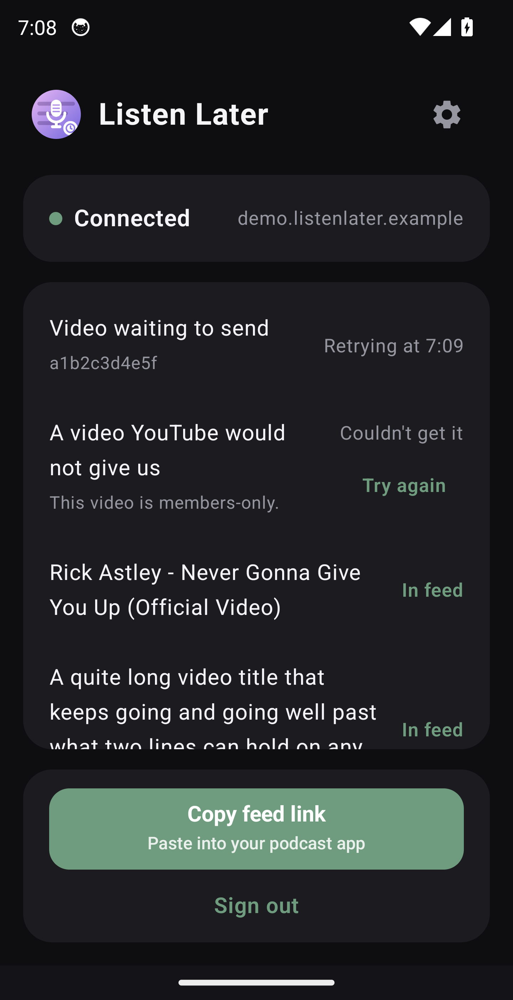

# Listen Later - details

Requires Android 12 or newer.

## Screenshots

  
  

## Setup

- A self-hosted [PigeonPod](https://github.com/aizhimou/pigeon-pod) server you can sign in to.
- Your server address (https only), username, and password. If your server
  asks for a captcha at login, the app shows the same picture.
- Any podcast app that can subscribe to an RSS feed.

## Install and updates

Download the APK from the [download page](https://mtndaleredneck.github.io/Listen-Later/),
open it, and allow installation from your browser or file manager if
Android asks. You need an existing PigeonPod server with an HTTPS address,
username and password. After signing in, tap "Copy feed link" and add that
link to your podcast app. The app offers new versions automatically; you
can also open the gear icon, then "Check for updates". Install updates over
the existing app without uninstalling it. Tap the server address on the
main screen to open your server in the browser.

## How it works

1. Sign in with your server address and login. When the session expires,
   the app asks you to sign in again. "Remember me on this device" (on by
   default) keeps the next sign-in prefilled, including across sign-out;
   unchecking it wipes the saved password.
2. Share a YouTube video to Listen Later, from YouTube or any app sharing
   its link (individual videos, not whole playlists). One tap, nothing
   opens. If you're signed out, the video is saved and you'll see "Saved.
   Open Listen Later and sign in to send it." If you're offline or your
   server can't be reached, it stays saved and keeps trying.
3. The video appears in your Individual Videos podcast feed. Subscribe to
   that feed once in your podcast app (the app has a Copy feed link button
   for the feed link) and new shares show up by themselves.

The app never changes feed settings. Quality, retention, and everything
else stay wherever you set them on your server's website. Sharing a video
that's still downloading shows "Already downloading". If an older video's
download was removed or failed, sharing it again can start another
download.

## Privacy

Your server address, login token, and feed link are stored only in the
Android Keystore-backed encrypted preferences on your phone. Your password
is stored in the same Keystore-encrypted storage only while "Remember me on
this device" is on (it is on by default); unchecking it wipes the saved
password. Signing out keeps the remembered login so the next sign-in is
prefilled. Your password is never written in plain text and never logged.

Video and feed requests go to your own server. When the signed-in main
screen opens, the app also checks GitHub for updates; you can check
manually in Settings. The check is one unauthenticated HTTPS GET to the
GitHub API asking for this app's latest public release. That request carries no body and no
credentials - just the ordinary HTTPS headers every client sends, including
a "ListenLater" user-agent - and none of your server, login, or feed data.
Like any HTTPS request it comes from your phone's IP address, which GitHub
sees. If you tap Update in the pop-up, the APK itself downloads from GitHub
over HTTPS. There is no switch for the update check; it is part of the app.

Settings also has Feedback. Before opening a public GitHub issue or a
private form, the app shows your message, app version, Android version and
phone model. Your server address and sign-in details are not added to the
report.

## If a video hasn't arrived

Open Listen Later to see whether it's sending, waiting for sign-in or
waiting to retry. If the server can't get a video, it appears under
"Couldn't get it" with a "Try again" button. These failed entries clear
themselves after about a day. You can also pull down to refresh the list.
