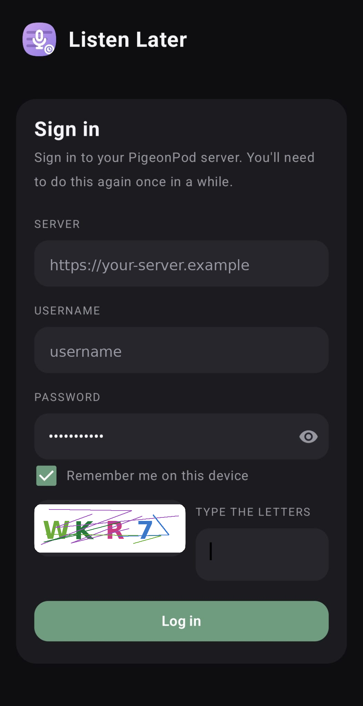
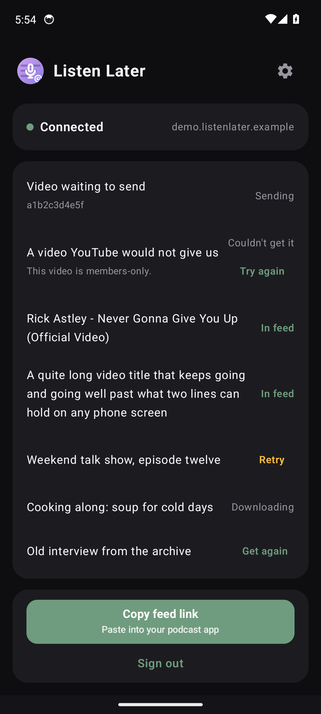

# Listen Later - details

Requires Android 12 or newer.

## Screenshots

  
  

## Setup

- A self-hosted [PigeonPod](https://github.com/aizhimou/pigeon-pod) server you can sign in to.
- Your server address (https only), username, and password. If your server
  asks for a captcha at login, the app shows the same picture.
- Any podcast app that can subscribe to an RSS feed.

## How it works

1. Sign in once with your server address and login. When the session
   expires, the app asks you to sign in again. "Remember me on this device"
   (on by default) keeps the next sign-in prefilled, including across
   sign-out; unchecking it wipes the saved password.
2. Share a video to Listen Later from any app. One tap, nothing opens, a
   toast confirms it was sent.
3. The video appears in your Individual Videos podcast feed. Subscribe to
   that feed once in your podcast app (the app has a Copy feed link button
   for the feed link) and new shares show up by themselves.

The app never changes feed settings. Quality, retention, and everything
else stay wherever you set them on your server's website. Sharing the same
video twice gets you an "already in your feed" toast, not a second download.

## Privacy

Your server address, login token, and feed link are stored only in the
Android Keystore-backed encrypted preferences on your phone. Your password
is stored in the same Keystore-encrypted storage only while "Remember me on
this device" is on (it is on by default); unchecking it wipes the saved
password. Signing out keeps the remembered login so the next sign-in is
prefilled. Your password is never written in plain text and never logged.

Two things use the network. Everything about your videos and your feed goes
only to your own server. Separately, each time the app cold-opens it checks
for app updates: one unauthenticated HTTPS GET to the GitHub API asking for
this app's latest public release. That request carries no body and no
credentials - just the ordinary HTTPS headers every client sends, including
a "ListenLater" user-agent - and none of your server, login, or feed data.
Like any HTTPS request it comes from your phone's IP address, which GitHub
sees. If you tap Update in the pop-up, the APK itself downloads from GitHub
over HTTPS. There is no switch for the update check; it is part of the app.
